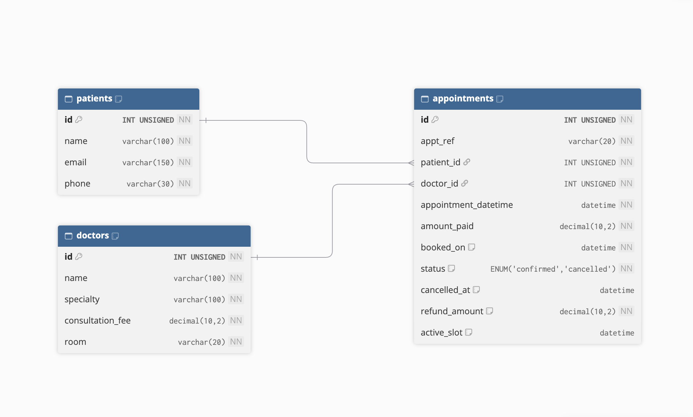

# MediBook

A clinic appointment booking backend built with Node.js, Express, MySQL, and Redis.

## Current progress: Day 2

The Express setup and database design are ready. The database has exactly three tables: patients, doctors, and appointments. The schema, sample data, and diagram are included. CRUD and appointment workflows come next. The original assessment instructions are preserved below.

## Requirements

- Node.js 24 LTS and npm
- MySQL 8.4, running locally
- Redis, running locally

## Setup

1. Install the packages:

   ```bash
   npm install
   ```

2. Create the local environment file:

   ```bash
   cp .env.example .env
   ```

   Update the MySQL username and password in `.env` to match your installation. Change the hosts and ports if your services use different ones. Keep `.env` out of Git; `.env.example` contains the settings to copy.

3. Start MySQL and Redis using your local installation. From the project root, create the database and load the sample data:

   ```bash
   mysql -u root -p < database/schema.sql
   mysql -u root -p < database/seed.sql
   ```

   Run these scripts once on a fresh database. The schema creates `medibook` and its tables; the seed script expects empty tables. If you already created an empty `medibook` database during Day 1, that works too. Neither script deletes existing data. Use your configured MySQL username if it is not `root`.

4. Start the API:

   ```bash
   npm start
   ```

   The application checks MySQL and Redis before listening. If either connection fails, it prints an error and exits. Check the service and `.env` settings, then restart the API.

5. Check the route:

   ```bash
   curl http://localhost:3000/health
   ```

   Expected response:

   ```json
   { "message": "MediBook API is running" }
   ```

   This route checks that the API is running. Database connections are checked at startup.

## Development

```bash
npm run dev
```

Node.js watch mode restarts the API when source files change. Press Ctrl+C to stop it.

## Structure

```text
database/                 schema.sql and seed.sql
src/
  app.js                  Express middleware and routes
  server.js               Connection checks and server startup
  config/                 MySQL and Redis clients
  controllers/            Request handling
  middleware/             Central error handler
  models/                 Application SQL will go here
  routes/                 URL and HTTP method definitions
```

Unknown routes return JSON with status 404. Malformed JSON bodies return status 400. Unexpected request errors return a generic 500 response.

The current packages are `express`, `mysql2`, `dotenv`, and `ioredis`. Development restarts use Node.js built-in watch mode. Queue processing and Jest tests will be added with the relevant features.

## Database design

View [the PDF diagram](schema-diagram.pdf) or the preview below. It includes every column, data type, primary/foreign key, relationship, and constraint from `database/schema.sql`.



- `patients` stores each patient's name, unique email, and phone.
- `doctors` stores each doctor's name, specialty, consultation fee, and room. Specialty and room describe the doctor in this small clinic; neither is treated as a separate lookup entity.
- `appointments` links one patient to one doctor and stores the appointment time, payment, booking time, and cancellation/refund details. Each patient and doctor can have zero or many appointments.

The design follows 3NF: each field holds one value, patient and doctor details are stored once under their own keys, and appointments reference those records instead of copying their details. `amount_paid` records an actual payment, which can differ from the doctor's current fee. Refund details belong to the cancelled appointment, so no fourth table is needed. Money uses `DECIMAL(10, 2)`.

### Preventing duplicate slots while retaining cancellations

`active_slot` is a generated value: it equals `appointment_datetime` for a confirmed booking and becomes `NULL` for a cancelled booking. It is computed by MySQL, not supplied by the application.

The unique constraint on `(doctor_id, active_slot)` allows only one confirmed booking for a doctor at a given time. MySQL allows multiple `NULL` values in a unique index, so cancelled rows remain available for refund history and the same slot can be booked again, including after repeated cancellations. The virtual column is an index helper, not a separately stored fact.

References: [MySQL generated columns](https://dev.mysql.com/doc/refman/8.4/en/create-table-generated-columns.html) and [unique indexes](https://dev.mysql.com/doc/refman/8.4/en/create-index.html).

### Rules enforced by the schema

- Required fields cannot be `NULL`; patient emails and appointment references must be unique.
- Foreign keys require an existing patient and doctor. Referenced patients and doctors cannot be deleted or have their IDs changed.
- Consultation fees and payments cannot be negative. A refund must be between zero and the amount paid.
- Confirmed bookings have no cancellation time and zero refund. Cancelled bookings require a cancellation time.
- Appointment starts are on a 30-minute boundary from 09:00 through 16:30, with zero seconds.
- A doctor cannot have two confirmed appointments at the same date and time.

The future-date rule, concurrent enforcement of the 12-per-day limit, and refund percentages will be implemented in the later booking/cancellation steps. They are not enforced by this schema alone. Cancellation and refund changes will update the same appointment row inside a transaction. The waitlist will live in Redis.

### Sample data

`database/seed.sql` loads 3 patients, 3 doctors, and 13 appointments in one transaction:

- Dr. Boateng has 11 confirmed appointments three days after the seed runs, leaving one place under the daily cap of 12.
- Dr. Adjei has one confirmed appointment four days after the seed runs, with a partial payment of 80.00 against a 100.00 fee.
- Dr. Mensah has no appointments, for testing the later all-doctors report.
- One cancelled appointment keeps a full refund of 150.00. Its 09:00 slot is already rebooked by a different patient.

The dates are relative to the MySQL session's current date so the sample bookings start in the future. Re-running the seed script on populated tables will report duplicate IDs; it is not a reset script.

---

# Final Assessment — Backend Development

**Weight:** 30% of final grade
**Duration:** 2 weeks
**Mode:** Individual project
**Stack (mandatory):** Node.js, Express.js, MySQL (with parameterized queries only), Redis

---

## Scenario — "MediBook" Clinic Appointment System

A community clinic wants a backend service for booking doctor appointments. Doctors see patients in fixed 30-minute slots during working hours (09:00–17:00), each doctor can handle at most **12 appointments per day**, and the clinic administrator needs reports. You will design the database, build the API, and handle the operational concerns (background jobs, logging, testing).

**Entity limit:** Your database must contain **exactly 3 entities**:

| Entity | Purpose |
|---|---|
| `patients` | People who book appointments |
| `doctors` | Doctors with a specialty, consultation fee, and room |
| `appointments` | A patient's booking with a doctor at a specific date/time (links the other two) |

You may add columns as needed, but no additional tables (lookup/locale JSON files don't count).

---

## Part A — Database Design & Normalization

The clinic currently tracks everything in this single spreadsheet:

| appt_ref | patient_name | patient_email | patient_phone | doctor_name | specialty | consultation_fee | room | appt_datetime | amount_paid | booked_on |
|---|---|---|---|---|---|---|---|---|---|---|
| AP-001 | Ama Mensah | ama@mail.com | 0244-111-222 | Dr. Boateng | Dermatology | 150.00 | R-12 | 2026-08-10 09:00 | 150.00 | 2026-07-01 |
| AP-002 | Kojo Owusu | kojo@mail.com | 0555-333-444 | Dr. Boateng | Dermatology | 150.00 | R-12 | 2026-08-10 09:30 | 120.00 | 2026-07-02 |
| AP-003 | Ama Mensah | ama@mail.com | 0244-111-222 | Dr. Adjei | Paediatrics | 100.00 | R-03 | 2026-08-15 10:00 | 100.00 | 2026-07-03 |

Study the spreadsheet, then produce a **database schema diagram** of your design in fully normalized form (up to 3NF). The diagram must show **everything**:

- all 3 entities with every column and its MySQL data type,
- primary keys and foreign keys, clearly marked,
- the relationships between the entities and their cardinality (1:N, etc.),
- every constraint that enforces a business rule (`NOT NULL`, `UNIQUE`, `CHECK`) — in particular, it must be visible from the diagram that *a doctor cannot have two appointments at the same date/time*.

Use any tool you like (dbdiagram.io, draw.io) and include it in your repository as `schema-diagram` (image or PDF).

## Part B — Database Implementation & Project Setup

1. **Table creation.** Translate your Part A diagram into a MySQL DDL script, `database/schema.sql`, that creates the database and the 3 tables — data types, primary keys, foreign keys, and every constraint shown on the diagram. The script must run cleanly on a fresh MySQL server. Also provide `database/seed.sql` with realistic sample data: at least 3 patients, 3 doctors (including one with no appointments), and 8 appointments (including one doctor-day at or near the 12-slot daily cap).

2. **Project structure.** Set up the Express project in a **models / controllers / routes** structure:

```
├── database/          schema.sql and seed.sql (Part B.1)
└── src/
    ├── models/        all application SQL lives here — nowhere else
    ├── controllers/   business logic; calls model functions, never the DB directly
    └── routes/        maps URLs and HTTP methods to controllers
```

Every SQL statement in the application must use **parameterized queries** (`?` placeholders via `mysql2`). SQL found in a controller or route file loses marks. **Do not use any ORM for this assignment.**

## Part C — Controllers & Endpoints

Implement endpoints for the operations below. **Designing the API is part of the assessment**: you choose the URL paths, the HTTP methods, and how the endpoints are grouped into controllers and routes — your choices should follow REST conventions and will be marked. The business rules listed are **requirements** — *how* you satisfy them is your design decision, and you will be asked to defend it at the viva.

1. **Basic CRUD** — standard **C**reate, **R**ead (one and all), **U**pdate, and **D**elete operations for patients and for doctors, with sensible validation. (Appointments get their create/delete behaviour from the two operations below — no separate CRUD needed there.)

2. **Book an appointment**. Rules that must always hold:
   - Appointments can only be booked in the future, within working hours (09:00–17:00), on a 30-minute slot boundary.
   - A doctor never exceeds 12 appointments in a day.
   - Two patients can never hold the same doctor slot — even when both requests arrive at the same instant.

3. **Cancel an appointment**. Rules:
   - The refund is computed by the server from the notice given: more than 48 hours → 100%; 24–48 hours → 50%; less than 24 hours → 0%. The response states the refund amount.
   - The cancellation and its refund record succeed or fail together.
   - A cancelled slot becomes bookable by another patient, while the cancellation record is kept for refund history.
   - A cancellation notifies the waitlist (Part E).

4. **Doctor statistics** — for a given doctor: revenue collected, upcoming appointment count, appointments per day for the next 7 days, and utilization % against the 12-slot daily cap.

Operations 5 and 6 are where your **advanced SQL** is assessed: the results must be produced by the SQL in your models (joins, aggregates, etc) — not fetched raw and computed in JavaScript.

5. **Doctors report** — every doctor's total appointments and revenue collected, including doctors with zero appointments.
6. **Busy days report** — every (doctor, date) where more than 80% of the 12-slot daily capacity is booked.

### General requirements (all endpoints)

Input validation with meaningful `400` messages; correct status codes (`201`, `404`, `409`, `422`); a central error-handling middleware.

## Part D — Node.js `fs` Module

**Audit log:** every successful booking and cancellation must be appended as a JSON line to `logs/audit.log` using the `fs` module (async, non-blocking — no `*Sync` calls inside request handlers). The logger must create the `logs/` directory on first run if it doesn't exist, and a logging failure must **not** fail the user's request.

## Part E — Queues & Redis

1. **Waitlist queue:** when the requested slot (or the doctor's whole day) is fully booked, offer the patient a waitlist spot — push them onto a queue (Redis list, or Bull/BullMQ). When a cancellation frees a slot, a **worker process** (separate from the web server) pops the first waitlisted patient and books them in. Think through: what happens if the promoted booking itself fails? The patient must not simply vanish from both the queue and the appointments table.
2. **Notification jobs:** every confirmed appointment enqueues a "confirmation SMS/email" job; the worker processes it by writing the message to the audit log (no real sending needed).

## Part F — Unit Testing

Using Jest, write **at least 6 meaningful unit tests**:

- The refund calculator from Part C.3 — cover all three tiers **and both boundaries** (exactly 24 hours, exactly 48 hours). Boundary behaviour must match your documented policy.
- One validation function of your choice — e.g., the slot-alignment/working-hours check — including at least one edge case (17:00 exactly? 09:15? a malformed date?).

Tests must not require a live MySQL or Redis connection — that's the point of extracting pure functions. `npm test` must run them.

## Part G — i18n & l10n: Course Feedback Page

Create a **simple HTML page** (served by your Express app at `GET /feedback`) containing a short course-feedback form with **exactly 5 essay questions** (each answered in a `<textarea>`):

1. Which topic in this course did you find most challenging, and why?
2. Describe one concept you understood only after the practical assignments. What made it click?
3. How has your approach to designing databases or APIs changed since the start of the trimester?
4. What would you improve about how this course was taught or assessed?
5. How do you plan to apply what you learned in this course going forward?

**i18n/l10n requirement (keep it simple):** the page title, instructions, and all 5 questions must be loaded from locale files (e.g., `locales/en.json` and `locales/fr.json` — English plus one other language of your choice). Visiting `/feedback?lang=fr` shows the translated page; the default is English, and an unsupported `lang` value must fall back to English rather than crash. Display today's date on the page formatted for the active locale (e.g., using `Intl.DateTimeFormat`).

---

## Submission Requirements

- Git repository (with meaningful commit history — a single "final commit" will be questioned) containing:
  - `schema-diagram` (image or PDF), `schema.sql`, and `seed.sql` (as specified in Part B)
  - Application source, worker process, tests, locale files
  - `README.md` with: setup steps, `.env.example`, and the short written justifications requested in Parts C, D, and E
- The app must start with `npm install && npm start` (plus documented MySQL/Redis setup) and tests with `npm test`.
- A short **viva/demo (10 minutes)** walkthrough.

**Automatic penalties:** SQL injection vector anywhere in the app (−15), secrets committed to the repo (−5), app does not start per README instructions (−10), work the student cannot explain in the video (or at a follow-up viva if called) | Academic integrity referral; affected criteria re-scored at Developing or below |
